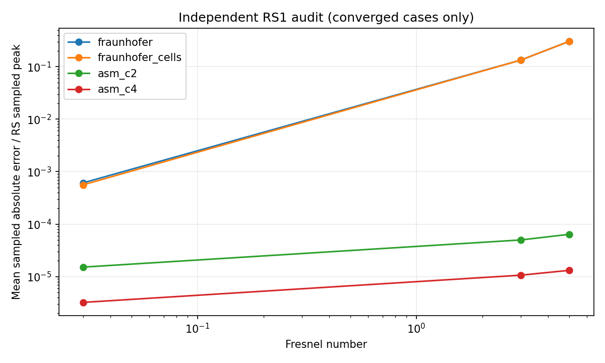

# Aperture-Diffraction

普通物理学实验 II：可微物理传播与神经网络的光阑衍射探究。

当前已完成**第一阶段：多菲涅耳数下的理想正向预测、物理层替换和收益归因**。项目从最初的远场FFT实验，扩展到有限距离传播与独立积分验证。逆向重建和含干扰双向系统仍待开展。

[阶段结果与图表](docs/phase1_results/README.md) · [阶段检查点](docs/PHASE1_CHECKPOINT.md) · [运行说明](fresnel_experiment/README.md) · [GitHub上传清单](docs/UPLOAD_GUIDE.md)

## 这段时间完成了什么

| 最初的远场版本 | 当前进度（2026-10-16） |
|---|---|
| 单一远场FFT仿真 | 七组菲涅耳数：0.01、0.03、0.1、0.3、1、3、5 |
| 仅夫琅禾费物理层 | 新增零可学习参数、可微的缩放角谱层，可选fraunhofer/asm/hybrid |
| 主要比较网络与基线 | 加入纯物理、epoch0和冻结模型对照，区分传播模型收益与网络收益 |
| 原理及标准光阑自检 | 新增24个光阑、72例独立RS1直接积分与网格收敛检查 |
| 基础训练日志 | 新增逐轮训练、验证、保存、单模型及总运行时间 |
| 单次运行输出 | 共享ID划分、物理元数据、独占新目录、哈希核验和阶段检查点 |

已完成的主要运行：七组分别训练夫琅禾费＋残差与基线，各50轮；七组纯角谱参照；NF=3、5分别训练10轮角谱残差模型；独立RS1检查全部通过预设收敛门槛。

## 当前实验回答了什么

### 大菲涅耳数下，原夫琅禾费近似出现误差

以下为每组96张相同ID测试图的归一化log强度MAE：

| NF | 纯夫琅禾费 | 夫琅禾费＋残差 | 纯角谱（单精度） | 角谱＋残差最佳 |
|---|---:|---:|---:|---:|
| 3 | 0.00202053 | 0.00167484 | 1.53131e-9 | 1.53131e-9（epoch0） |
| 5 | 0.00407073 | 0.00281578 | 2.25287e-9 | 2.25287e-9（epoch0） |

来源：[原模型汇总](docs/phase1_results/forward_summary.csv)、[角谱换层汇总](docs/phase1_results/asm_training_summary.csv)。近场标签由同一角谱算法生成，因此近零分数主要说明实现一致性。角谱残差的最佳权重均未经过更新，不能将换层收益计为新增神经网络收益。

### 独立RS1积分支持角谱的物理优势

另生成24个新光阑，八类各3个，与原1000个输入无重复；检查NF=0.03、3、5，共72例。每例73至82个共同观察点，采用独立RS1直接积分并逐级加密，全部通过收敛检查。

为控制离散差异，夫琅禾费加入解析sinc像素面积因子，与RS1、角谱采用相同的常透过率像素单元解释。主指标为抽样绝对强度误差的均值除以RS抽样峰值，再跨24例平均：

| NF | 同像素面积夫琅禾费 | 当前角谱 | 角谱更优案例 |
|---|---:|---:|---:|
| 0.03 | 5.60503e-4 | 1.51730e-5 | 19/24 |
| 3 | 0.133510 | 4.99791e-5 | 24/24 |
| 5 | 0.304586 | 6.40216e-5 | 24/24 |

此指标与前表的全图log MAE定义不同。NF=3、5的改善均超过参考末次平均加密变化的5倍；它是数值判别门槛，不是严格误差界或统计显著性检验。



角谱在大NF下的优势有独立传播依据，不能全部解释为复现标签生成器。加密角谱网格还会继续降低误差，说明当前实现仍有离散计算误差。

### 残差网络的作用需要分别判断

旧夫琅禾费残差网络在新光阑的归一化图样辅助比较中，NF=3、5的平均误差分别降低26.32%、32.14%，支持它能够补偿部分近似误差。匹配角谱层后，两组新模型均选择零残差epoch0，尚未提供额外收益。完整口径、学习曲线及逐例数据见[阶段结果](docs/phase1_results/README.md)。

## 模型与物理约定

物理引导模型为：

$$
\hat I = \Phi(a,z) + R_\theta(a,\Phi(a,z),c),
$$

其中a为256×256光阑，Phi为固定可微传播层，c为按训练集统计归一化的log(z)和log(观察面像素间距)。基线使用同类U-Net，直接由a和c预测图样。

- 物理层可微、无可学习参数；自由残差并不保证最终输出非负、能量守恒或严格满足传播方程。
- 默认输入像素间距10微米、波长532纳米，D为占用包围盒较长轴向跨度，NF=D²/(lambda*z)。
- NF=0.01、0.03标签采用夫琅禾费FFT，其余五组采用缩放角谱。0.1是本实验切换点，不是普适物理边界。
- 观察面像素间距为lambda*z/(N*input_pitch)，属于缩放观察面，不能直接解释为固定相机实验。
- 七组共享1000个原始光阑及808/96/96划分，共7000对样本；当前不加光阑噪声、整体乘性缩放或独立观测噪声。
- 每组独立训练，尚未验证跨NF外推。公共损失为空间L1＋0.1×频域log幅度L1，SSIM共同关闭；残差分支另加1e-3残差正则。
- epoch0参与验证选优，测试集在选好权重后使用。PSNR采用固定数据范围1，与早期脚本定义不同。

角谱内部也使用FFT；这里比较的是传播模型的近似及数值实现，不是“是否使用FFT”。详细实现见[物理与训练说明](fresnel_experiment/README.md)。

## 安装与快速检查

在项目根目录运行。先按[PyTorch官方说明](https://pytorch.org/get-started/locally/)选择适合CPU/GPU的安装版本，再安装依赖：

```bash
python -m pip install -r requirements.txt
python -m unittest fresnel_experiment.test_pipeline fresnel_experiment.test_rs1_audit -v
```

本机通过11项测试。实测环境：Python 3.11.16、NumPy 1.23.5、Matplotlib 3.7.2、PyTorch 2.14.0+cu130，RTX 5070 Laptop GPU；详见[环境记录](docs/phase1_results/environment.json)。CUDA版本需按自己的设备选择，程序会实际探测计算能力。

小规模流程检查（64×64、24个输入，每组每模型1轮）：

```bash
python -m fresnel_experiment.validate --grid 64 --out fresnel_checks/demo
python -m fresnel_experiment.generate --grid 64 --samples 24 --validation fresnel_checks/demo/validation.json --out fresnel_data/demo
python -m fresnel_experiment.train --data fresnel_data/demo --base-ch 8 --batch-size 4 --epochs 1 --out fresnel_runs/demo
```

小网格用于验证流程，不能作为正式性能结论。所有输出目录必须不存在；再次运行须换新名称。

## 完整复现本次实验

仓库只提供轻量结果，原始数据及权重需要重新生成。以下目录使用新的reproduce名称，避免覆盖维护者已有结果；正式数据约占4.2 GB。

```bash
# 1. 传播验证、生成1000个原始光阑及七组标签
python -m fresnel_experiment.validate --out fresnel_checks/reproduce_v1
python -m fresnel_experiment.generate --samples 1000 --validation fresnel_checks/reproduce_v1/validation.json --out fresnel_data/reproduce_v1

# 2. 原夫琅禾费＋残差与基线：七组分别训练50轮
python -m fresnel_experiment.train --data fresnel_data/reproduce_v1 --epochs 50 --out fresnel_runs/reproduce_fft

# 3. 同一数据上的纯角谱及冻结模型参照
python -m fresnel_experiment.reference --data fresnel_data/reproduce_v1 --compare-run fresnel_runs/reproduce_fft --out fresnel_reference/reproduce_v1

# 4. 重点两组角谱残差：各10轮
python -m fresnel_experiment.train --data fresnel_data/reproduce_v1 --groups 3 5 --models physics --propagator asm --epochs 10 --batch-size 4 --out fresnel_runs/reproduce_asm

# 5. 独立RS1验证：新光阑，不更新权重
python -m fresnel_experiment.rs1_audit --data fresnel_data/reproduce_v1 --old-run fresnel_runs/reproduce_fft --asm-run fresnel_runs/reproduce_asm --out fresnel_checks/reproduce_rs1
```

设备默认为auto；可显式选择`--device cuda`或`--device cpu`。CPU也可运行，耗时取决于设备。不同软硬件和浮点计算可能产生数值差异。

训练控制台和`history.csv`记录每轮训练、验证及累计时间；模型与运行目录另存`timing.json`和`timing_summary.csv`。GPU计时在边界同步，旧训练未记录的耗时不会补填。

## 上传代码与目录结构

```text
Aperture-Diffraction/
  README.md, requirements.txt, .gitignore
  generate_data.py            # 复用八类几何；导入不创建旧data目录
  train.py                   # 保留旧模型/损失；新模块复用ConvBlock、Loss
  baseline.py, evaluate.py    # 早期实验入口
  fresnel_experiment/         # 多NF数据、模型、训练、参照、RS1与测试
  docs/
    PHASE1_CHECKPOINT.md      # 当前公开检查点
    UPLOAD_GUIDE.md           # 上传清单、依赖及排除项
    legacy_far_field.md      # 早期实验及解释修正
    phase1_results/          # 轻量CSV/JSON/图及来源哈希
```

完整数据、权重、工作目录和本机审计快照由`.gitignore`排除，所需展示材料另存`docs/phase1_results/`。保留根目录`train.py`和`generate_data.py`，新模块仍依赖它们。详细上传文件见[清单](docs/UPLOAD_GUIDE.md)。

## 后续工作

| 内容 | 状态 |
|---|---|
| 多NF理想正向预测、换层与收益归因 | 已完成 |
| 固定可重复系统偏差下的校准与残差对照 | 待开展 |
| 逆向光阑重建 | 待开展 |
| 含噪、毛玻璃等干扰下的双向系统 | 待开展 |

当前结论限于理想标量仿真和已检查的样本、观察点。独立随机观测噪声不能由理想光阑逐次预测；后续残差研究需要明确可学习的系统偏差。早期远场流程和历史指标见[历史实验说明](docs/legacy_far_field.md)。
