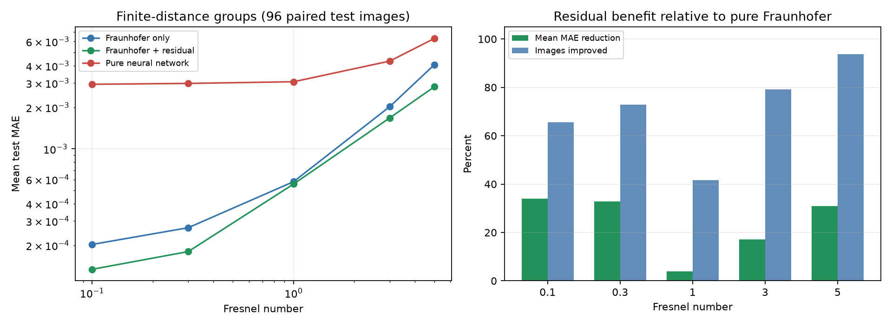
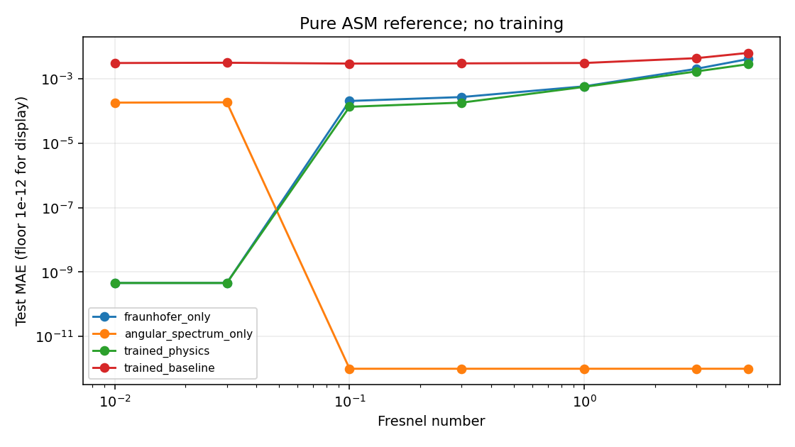
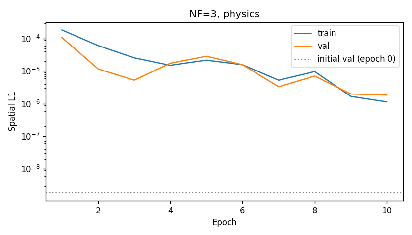
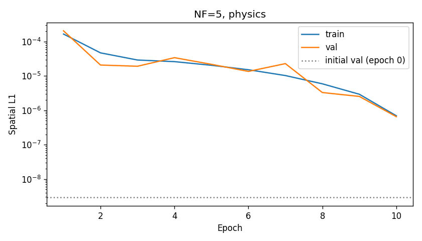
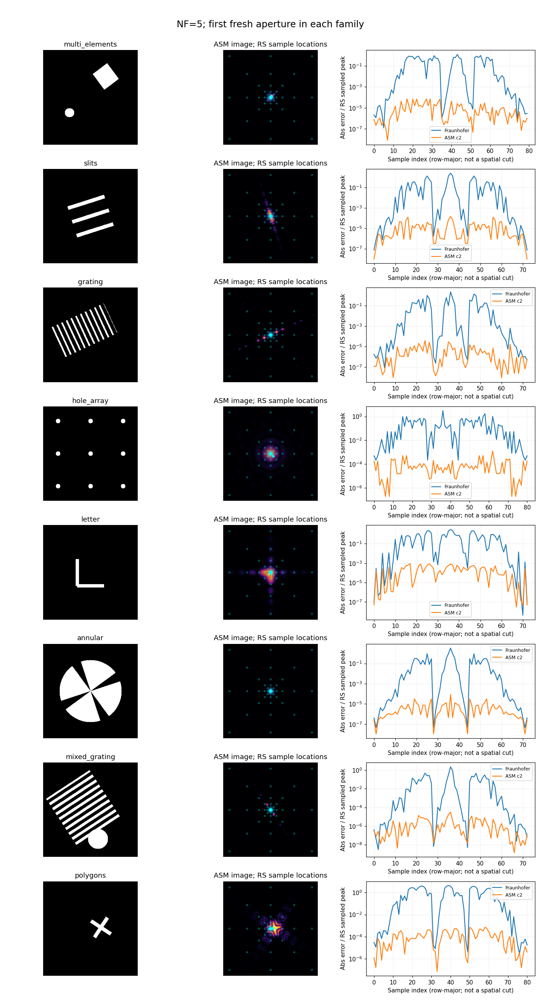

# 第一阶段结果与来源

这里保存用于GitHub展示的轻量指标和图，取自维护者已经完成的实验；不附带原始大数组或模型权重。26个原始文件逐字节复制，来源、大小和SHA256见[source_manifest.json](source_manifest.json)。配置见[experiment_configs.json](experiment_configs.json)，本机实测环境见[environment.json](environment.json)。

## 1. 多菲涅耳数组训练

1000个原始光阑，每组1000对输入/标签，七组共享808/96/96划分。每组分别训练夫琅禾费＋残差与纯网络基线，各50轮。每组独立初始化，不是跨NF外推实验。

| NF | 纯夫琅禾费MAE | 夫琅禾费＋残差MAE | 基线MAE |
|---|---:|---:|---:|
| 0.01 | 4.580e-10 | 4.580e-10 | 0.00305534 |
| 0.03 | 4.580e-10 | 4.580e-10 | 0.00311634 |
| 0.1 | 0.000203053 | 0.000134140 | 0.00293535 |
| 0.3 | 0.000268390 | 0.000180280 | 0.00297823 |
| 1 | 0.000578524 | 0.000555973 | 0.00306211 |
| 3 | 0.00202053 | 0.00167484 | 0.00432067 |
| 5 | 0.00407073 | 0.00281578 | 0.00630265 |

来源：[forward_summary.csv](forward_summary.csv)。指标针对96张测试图的归一化log输出，PSNR固定数据范围1。

大NF下原传播近似误差增大，残差只能补偿一部分。这次基线表现较差的结论限于当前配置与数据。

## 2. 角谱参照及换层训练

七组纯角谱与冻结模型比较：[asm_reference_summary.csv](asm_reference_summary.csv)。角谱参照默认双精度，网络单精度，速度不能直接作为同精度算法排名。

NF≥0.1的标签由同一角谱计算生成，因此接近零的结果首先验证实现一致性。远场标签是点采样FFT，角谱包含像素面积积分，二者的差别也包含离散方式差异。

| NF | 纯角谱测试MAE（单精度） | 角谱＋残差最佳MAE | 最佳轮次 |
|---|---:|---:|---:|
| 3 | 1.53131e-9 | 1.53131e-9 | 0 |
| 5 | 2.25287e-9 | 2.25287e-9 | 0 |

来源：[训练汇总](asm_training_summary.csv)、[NF=3选优](asm_nf3_selection.json)、[NF=5选优](asm_nf5_selection.json)。各训练10轮；第1轮已包含参数更新，必须与epoch0比较。

曲线下降没有超过未训练的零残差初始模型。最终保存的最佳模型均为epoch0。逐轮损失与计时见[NF=3历史](asm_nf3_history.csv)、[NF=5历史](asm_nf5_history.csv)，汇总耗时见[asm_timing_summary.csv](asm_timing_summary.csv)。

## 3. 独立RS1验证

新生成24个光阑（八类各3个），与原1000个输入逐一核对哈希无重复。在NF=0.03、3、5下共72例，每例73至82个共同观察点。独立RS1直接积分全部通过加密收敛门槛，69例使用8倍子像素，3例继续到16倍。

主指标为：每例抽样绝对强度误差的均值，除以该例RS抽样峰值，再跨24例平均。所有纯物理方法共享同一个RS分母；不是前两节的归一化log全图MAE。

`fraunhofer_cells`加入解析sinc像素面积因子，使夫琅禾费、RS1和角谱对输入像素作相同解释。`c2/c4`表示角谱2/4倍子像素。

| NF | 同像素面积夫琅禾费 | ASM c2 | ASM c4 | ASM c2更优案例 |
|---|---:|---:|---:|---:|
| 0.03 | 5.60503e-4 | 1.51730e-5 | 3.22790e-6 | 19/24 |
| 3 | 0.133510 | 4.99791e-5 | 1.06563e-5 | 24/24 |
| 5 | 0.304586 | 6.40216e-5 | 1.31783e-5 | 24/24 |

来源：[纯物理汇总](rs1_summary.csv)、[胜出计数](rs1_win_counts.json)。大NF的48例改善均大于参考末次平均加密变化的5倍；该门槛是数值判别规则，不是严格误差界或统计显著性检验。

角谱的优势在独立参照下仍成立；同时网格加密继续降低误差，表明现有角谱仍有离散计算误差。有限光阑和观察点不能证明全图、所有形状或真实实验的精度。

示例图右栏横轴为观察点编号，不是空间剖面；Fraunhofer曲线对应原点采样FFT，像素面积匹配的对照另见指标表。

## 4. 网络的辅助比较

冻结网络只有经过全图归一化的log输出，RS全图峰值由观察点估计，因此下面是辅助形状比较，不能用于绝对强度结论。

| NF | 纯夫琅禾费 | 旧夫琅禾费＋残差 | 纯角谱 | 角谱＋残差 |
|---|---:|---:|---:|---:|
| 3 | 0.137443 | 0.101271 | 0.000169970 | 0.000169969 |
| 5 | 0.205564 | 0.139492 | 0.000181884 | 0.000181880 |

旧残差网络的平均辅助误差分别下降26.32%、32.14%，分别18/24、19/24例改善；支持它能补偿部分近似误差。角谱残差权重则确认输出层全零，表中微小差别来自NumPy双精度和Torch单精度传播。

来源：[辅助网络汇总](rs1_model_summary.csv)、[核验记录](rs1_verification.json)。

## 数据索引

- [数据清单](dataset_manifest.json)、[原传播验证](propagation_validation.json)。
- [逐例物理指标](rs1_case_metrics.csv)、[逐级积分收敛](rs1_convergence.csv)、[逐例改善](rs1_comparisons.csv)。
- [逐例辅助网络指标](rs1_model_metrics_auxiliary.csv)、[独立验证完成记录](rs1_completion.json)。

公开配置保留原运行目录的相对名称以便溯源，这些目录需要重新生成。完整复现步骤见[项目README](../../README.md)，审计口径见[RS1说明](../../fresnel_experiment/RS1_AUDIT_README.md)。
